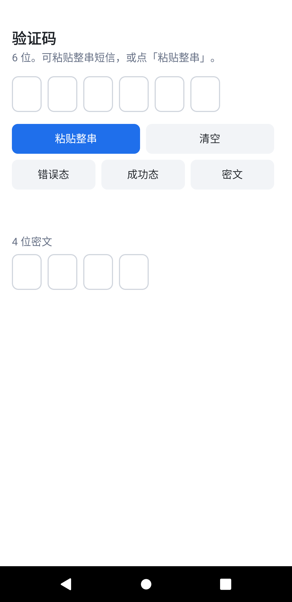
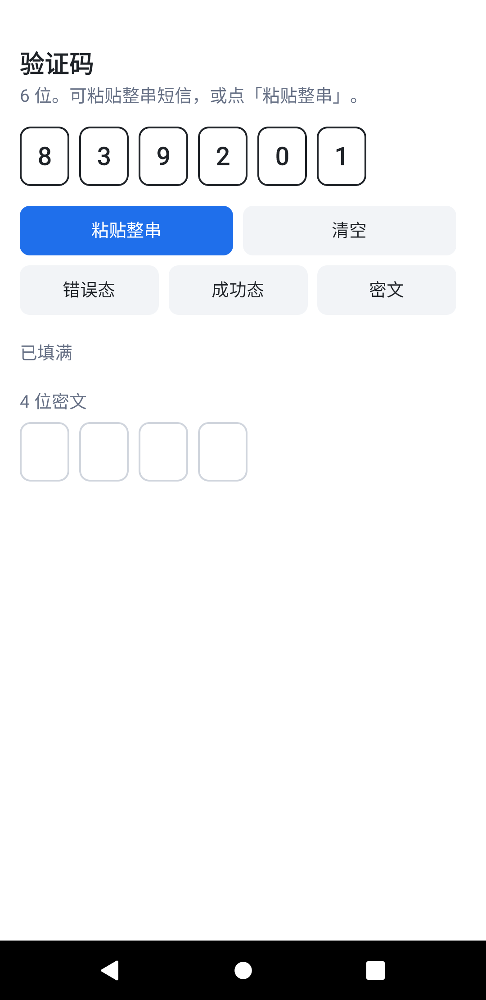
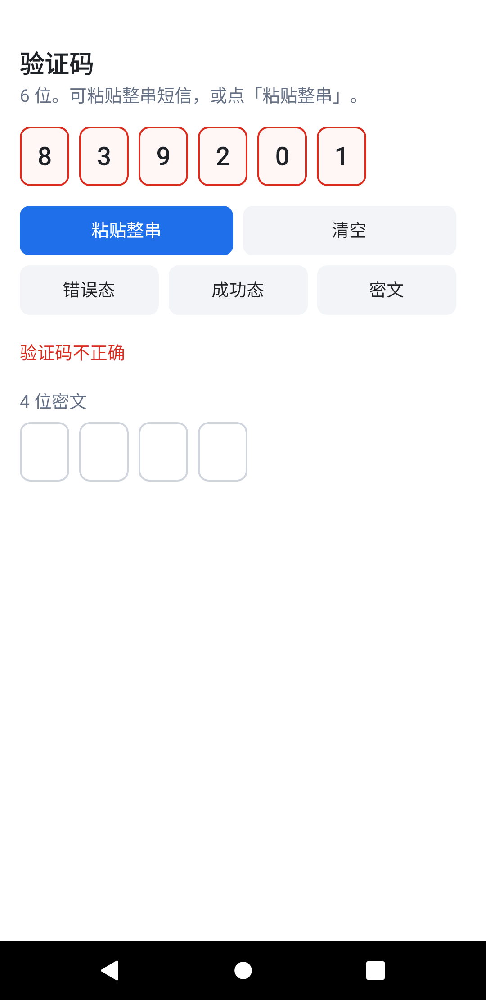

# KuiklyOtpInput

Kuikly 验证码输入，自研 DSL 与 Compose DSL 都能用。登录、绑卡、改密都可以接。

作者：[@FooWrites](https://github.com/FooWrites)

## 效果

自研 DSL · Android

<table>
  <tr>
    <td></td>
    <td></td>
    <td></td>
  </tr>
  <tr>
    <td align="center">空</td>
    <td align="center">填入 839201</td>
    <td align="center">错误态 · 验证码不正确</td>
  </tr>
</table>

空态待输入。填入后格子为 839201。错误态红框，提示「验证码不正确」。

## 安装

```kotlin
repositories {
    mavenCentral()
    maven("https://jitpack.io")
}
```

自研 DSL：

```kotlin
implementation("com.github.FooWrites.KuiklyOtpInput:otpinput:v0.1.1")
```

Compose DSL：

```kotlin
implementation("com.github.FooWrites.KuiklyOtpInput:otpinput-compose:v0.1.1")
```

`otpinput-compose` 已传递依赖 `otpinput`。本库基于 Kotlin 2.1.21 / Kuikly 2.4.2-2.0.21 构建。JitPack 只发布 `:otpinput` 和 `:otpinput-compose`，不编宿主。

## 输入方式

格子是画出来的。真正接收键盘、粘贴和系统自动填充的是盖在格子上的**一个**数字 `Input`，长度等于验证码位数，**不会**把每一格设成 `maxLength = 1`。

因此：

- 手动输入时，高亮跟着当前位数走；退格删掉最后一位，高亮回到上一格。
- 把整段短信贴进这一格（或系统一次性写入整串）时，只保留数字并按位填进格子，然后回调 `onChange` / 满位时 `onComplete`。
- 密文只影响格子上的显示，底层仍是数字，避免密码键盘抢走短信验证码。

### 自动填充

| 平台 | 行为 |
| --- | --- |
| Android | 宿主在页面加载后对底层 `EditText` 调用 `OtpAutofill.applySmsOtpHints(root)`，设置 `importantForAutofill` 和 hint `smsOTPCode`（即 `AUTOFILL_HINT_SMS_OTP`）。Gboard 一类键盘把验证码写进这一个输入框后，组件再拆开。Kuikly 2.4.2 的 Input **不会**自己带上这个 hint。 |
| iOS | 同样是一个数字输入框，粘贴整串可用。Kuikly 2.4.2 的 Input **没有**暴露 `textContentType = .oneTimeCode`，系统「来自短信」的快捷填充条不能只靠本库打开。宿主若能拿到底层 `UITextField`，需要自己设 `UITextContentTypeOneTimeCode`。 |
| 鸿蒙 / H5 | 粘贴整串、逐位输入、退格可用。Kuikly 2.4.2 不会给鸿蒙文本框或 H5 `input` 写一次性验证码的 content type / `autocomplete="one-time-code"`，这两端的系统自动填充不要当成已支持。 |

核心 UI 只用 Kuikly View 和 Input，不依赖浏览器 API，也不为输入逻辑起协程。

## 自研 DSL

```kotlin
OtpInput {
    ref { otpRef = it }
    attr {
        length(6) // 也支持 4，范围 1..8
        obscure(false)
        state(OtpInputState.Normal) // Error / Success 改边框颜色
        autofocus(true)
    }
    event {
        onChange { code -> }
        onComplete { code -> }
    }
}

otpRef.view?.setCode("短信验证码839201，请勿泄露") // 得到 839201
otpRef.view?.clear()
```

颜色状态由调用方切换，组件不会在继续输入时自己清掉错误态。组件固定占 48 高，调用方不用再包 `height(48f)`，也没有改高度的接口。

## Compose DSL

```kotlin
val controller = remember { OtpInputController() }
var state by remember { mutableStateOf(OtpInputState.Normal) }

OtpInput(
    modifier = Modifier.fillMaxWidth(),
    length = 6,
    obscure = false,
    state = state,
    controller = controller,
    onChange = { code -> },
    onComplete = { code -> },
)

controller.setCode("839201")
controller.clear()
```

同样固定占 48 高，不必再写 `.height(48.dp)`。调用方传入的高度不会改这一行。

## 本地示例

`:demo` 两页：`otp_input_demo`、`otp_input_compose_demo`。

`:androidApp` 默认打开 `otp_input_demo`。

```bash
adb shell am start -n com.foowrites.kuikly.otp.host/.KuiklyRenderActivity \
  --es pageName otp_input_demo
```

Compose 页把 `pageName` 换成 `otp_input_compose_demo`。

页面参数 `preset` 会在出现后写入验证码（会先去掉非数字），`state` 取 `error` 或 `success`：

```bash
adb shell am start -n com.foowrites.kuikly.otp.host/.KuiklyRenderActivity \
  --es pageName otp_input_demo \
  --es preset "短信验证码839201，请勿泄露" \
  --es state error
```

本仓库带了可安装的 Android 宿主。iOS / 鸿蒙 / H5 工程壳还没有放进来；页面名同上，接到对应 Kuikly 容器即可。

## 许可

Apache License 2.0

Copyright (c) 2026 FooWrites
