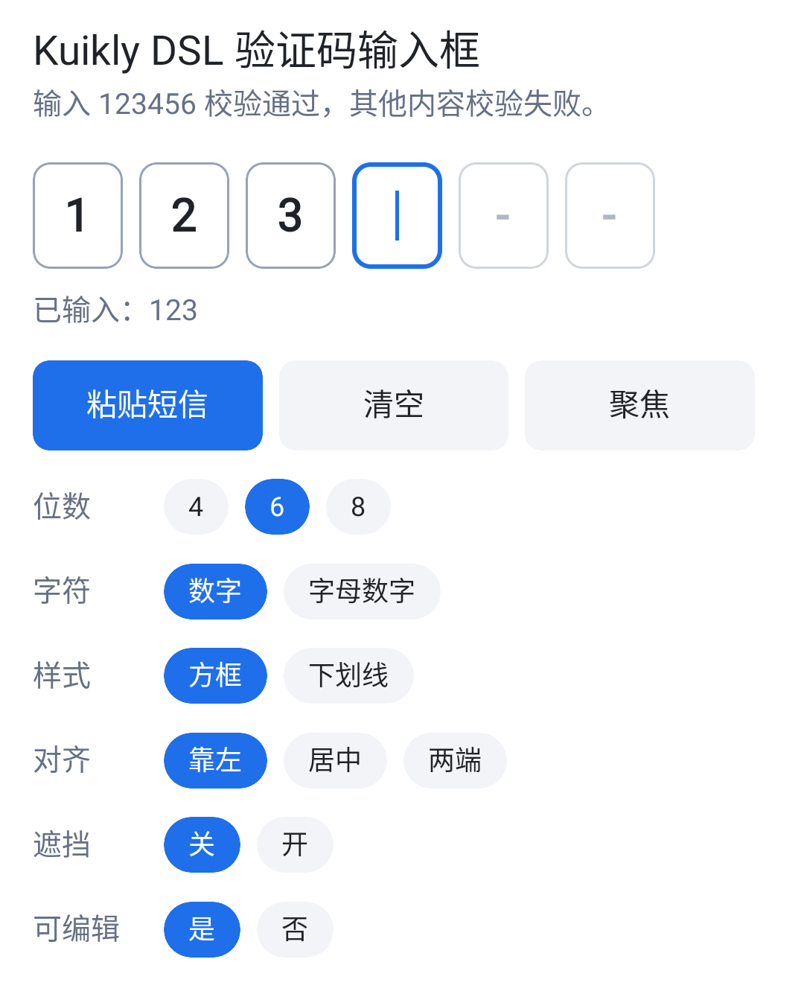
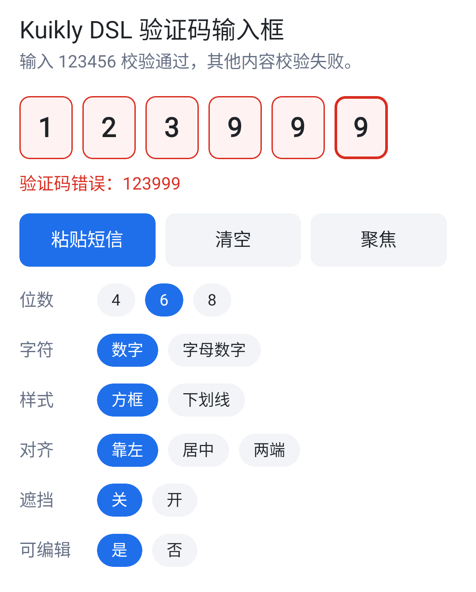
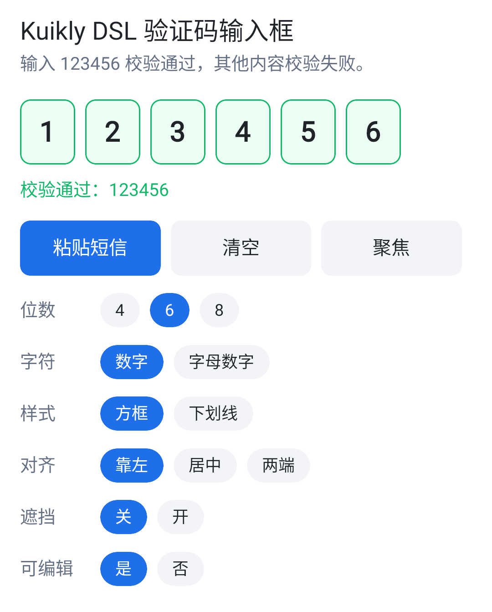
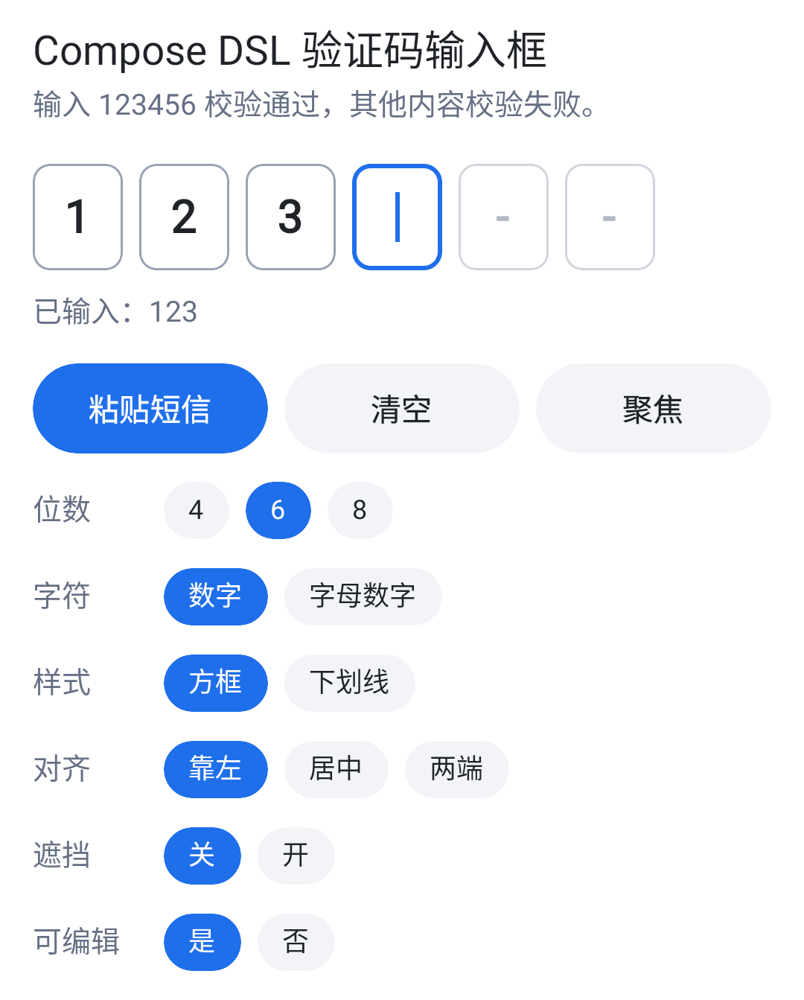
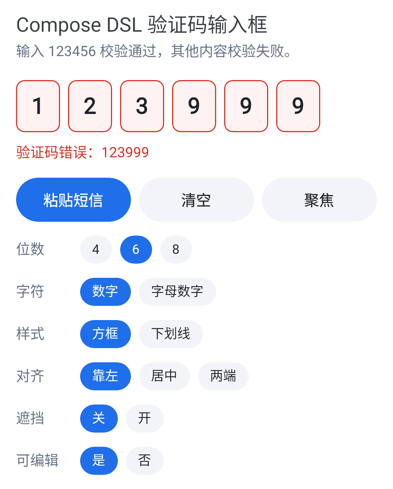
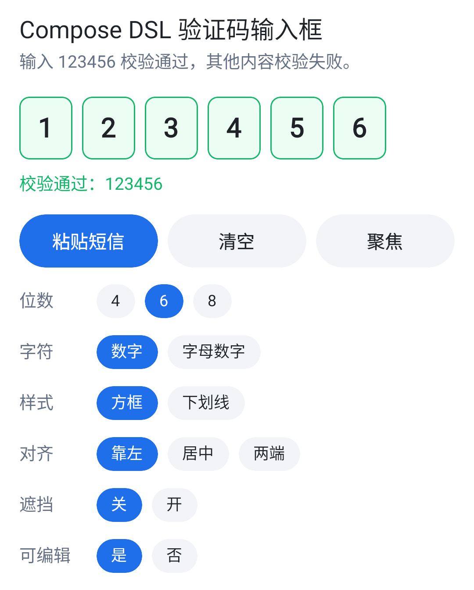

# KuiklyOtpInput

基于 Kuikly 的跨端验证码（OTP）输入框，支持 Android、iOS、HarmonyOS 和 H5。
提供 Kuikly DSL 和 Compose DSL 两个相互独立的模块，按页面使用的 DSL 引入其中一个即可。

支持系统键盘输入、长按粘贴、连续删除，以及可选的系统短信验证码填充：

- 连续输入时自动跳到下一格，连续删除时从最后一格依次删除，光标始终固定在末尾；
- 粘贴或一次写入整段文字（例如整条短信）时，提取其中的验证码替换当前内容；
- 填满后回调 `onComplete` 并默认收起键盘，同一个验证码只回调一次；
- 支持数字和字母数字两种字符集、遮挡显示、占位字符、方框和下划线两种样式，以及错误、成功两种校验状态。

## 截图

以下截图来自 Android Demo，分别展示 Kuikly DSL 和 Compose DSL 的输入中、校验失败和校验成功状态。

| Kuikly DSL 输入中 | Kuikly DSL 校验失败 | Kuikly DSL 校验成功 |
|---|---|---|
|  |  |  |

| Compose DSL 输入中 | Compose DSL 校验失败 | Compose DSL 校验成功 |
|---|---|---|
|  |  |  |

## 接入配置

### 依赖

添加 JitPack 仓库：

```kotlin
repositories {
    maven { url = uri("https://jitpack.io") }
}
```

在 KMP 共享模块的 `commonMain` 中添加依赖：

| 模块 | Android / iOS / H5 | HarmonyOS |
|---|---|---|
| Kuikly DSL | `com.github.FooWrites.KuiklyOtpInput:otpinput:0.2.0-2.1.21` | `com.github.FooWrites.KuiklyOtpInput:otpinput:0.2.0-2.0.21-KBA-010` |
| Compose DSL | `com.github.FooWrites.KuiklyOtpInput:otpinput-compose:0.2.0-2.1.21` | `com.github.FooWrites.KuiklyOtpInput:otpinput-compose:0.2.0-2.0.21-KBA-010` |

版本号格式为 `{组件版本}-{Kotlin 版本}`。Android / iOS / H5 产物基于 Kotlin `2.1.21`、Kuikly `2.29.2-2.1.21` 构建；
HarmonyOS 产物基于 Kotlin `2.0.21-KBA-010`、Kuikly `2.23.2-2.0.21-ohos` 构建。

接入工程需自行依赖 `com.tencent.kuikly-open:core`，使用 Compose DSL 时还需依赖 `com.tencent.kuikly-open:compose`。

添加依赖后即可使用输入、删除、粘贴和自动提交等全部功能。系统短信验证码填充是可选能力，需要时再在宿主工程中注册属性处理器，见[可选的短信验证码填充](#可选短信验证码填充)。

### 可选：短信验证码填充

短信验证码填充属于宿主渲染层配置，不是组件使用的必需步骤。不接入时，输入、删除、粘贴、`setCode` 和自动提交都不受影响，只是不保证系统出现验证码建议。可以只接入需要的平台。

组件在原生输入框上设置两个自定义属性，由宿主决定如何处理：

| 属性 | 取值 | 说明 |
|---|---|---|
| `otpAutofill` | `"on"` / `"off"` | 由 `smsAutofill` 决定，表示是否开启系统短信验证码填充 |
| `otpKeyboard` | `"numeric"` / `"text"` | 由 `charset` 决定，只有 H5 需要处理 |

宿主未处理时这两个属性会被忽略。短信填充建议由系统或输入法提供，是否出现取决于系统版本、输入法和短信内容。

#### Android

注册属性处理器，为输入框声明 Autofill 提示 `smsOTPCode`（Android 8.0 及以上）：

```kotlin
class KuiklyRenderActivity : AppCompatActivity(), KuiklyRenderViewBaseDelegatorDelegate {
    override fun registerViewExternalPropHandler(kuiklyRenderExport: IKuiklyRenderExport) {
        super.registerViewExternalPropHandler(kuiklyRenderExport)
        kuiklyRenderExport.viewPropExternalHandlerExport(KROtpAutofillHandler)
    }
}
```

`KROtpAutofillHandler` 见 [androidApp/src/main/java/com/kuikly/otp/KROtpAutofillHandler.kt](androidApp/src/main/java/com/kuikly/otp/KROtpAutofillHandler.kt)。需要无输入法依赖的一键填充时，可以在宿主中接入 SMS User Consent API，再通过 `setCode` 写入验证码。

#### iOS

把 [KRTextFieldView+OtpAutofill.m](iosApp/Sources/Handlers/KRTextFieldView+OtpAutofill.m) 加入宿主工程。该分类将 `textContentType` 设为 `UITextContentTypeOneTimeCode`，键盘上方会出现验证码建议：

```objc
@implementation KRTextFieldView (OtpAutofill)

- (void)setCss_otpAutofill:(NSString *)css_otpAutofill {
    BOOL enabled = css_otpAutofill.length > 0 && ![css_otpAutofill isEqualToString:@"off"];
    self.textContentType = enabled ? UITextContentTypeOneTimeCode : nil;
}

@end
```

#### H5

在 `KuiklyRenderViewDelegatorDelegate` 中注册属性处理器，为输入框设置 `autocomplete="one-time-code"` 和 `inputmode`：

```kotlin
class KuiklyWebRenderViewDelegator : KuiklyRenderViewDelegatorDelegate {
    override fun registerViewExternalPropHandler(kuiklyRenderExport: IKuiklyRenderExport) {
        super.registerViewExternalPropHandler(kuiklyRenderExport)
        kuiklyRenderExport.viewPropExternalHandlerExport(KROtpInputPropHandler())
    }
}
```

`KROtpInputPropHandler` 见 [h5App/src/jsMain/kotlin/KROtpInputPropHandler.kt](h5App/src/jsMain/kotlin/KROtpInputPropHandler.kt)。它还会去掉透明输入框的浏览器聚焦描边。未注册时，数字模式下弹出的是全键盘，聚焦时浏览器可能在组件外显示描边。

#### HarmonyOS

ArkUI 输入框没有验证码内容类型，宿主无需处理这两个属性。短信验证码填充由系统输入法识别，`DIGITS` 时组件使用数字键盘。

## 业务使用

### Kuikly DSL

#### 使用

通过 `ViewRef<OtpInputView>` 设置内容、清空和控制焦点：

```kotlin
import com.kuikly.otp.OtpInput
import com.kuikly.otp.OtpInputStatus
import com.kuikly.otp.OtpInputView

// Pager 的成员
private var otpRef: ViewRef<OtpInputView>? = null
private var status by observable(OtpInputStatus.NORMAL)

// body() 中，ctx 为当前 Pager
OtpInput {
    ref { ctx.otpRef = it }
    attr {
        justifyContentCenter()
        length = 6
        status = ctx.status
    }
    event {
        onChange { code -> ctx.status = OtpInputStatus.NORMAL }
        onComplete { code -> /* 提交校验，失败时设置 status = OtpInputStatus.ERROR */ }
    }
}

ctx.otpRef?.view?.setCode("123456")
ctx.otpRef?.view?.clear()
ctx.otpRef?.view?.focus()
```

格子是组件的直接子节点，组件默认 `flexDirectionRow()`、`alignItemsCenter()`。格子的水平排布和垂直对齐使用 Kuikly 原有的 `justifyContent` / `alignItems`，`padding` 等布局属性也按原有语义作用于组件。
组件宽度默认撑满父容器，高度由格子决定。

#### 属性

| 属性 | 类型 | 默认值 | 说明 |
|---|---|---|---|
| `length` | `Int` | `6` | 位数，取值 1..12，超出范围会被截断；缩短时丢弃多出的字符 |
| `charset` | `OtpCharset` | `DIGITS` | `DIGITS` 只允许数字；`ALPHANUMERIC` 允许数字和字母，字母转为大写。切换时按新规则过滤已有内容 |
| `editable` | `Boolean` | `true` | 为 `false` 时不能聚焦和输入，显示 disabled 系列颜色；聚焦时改为 `false` 会失焦 |
| `autofocus` | `Boolean` | `false` | 创建后自动聚焦并弹出键盘，只在创建时读取 |
| `blurOnComplete` | `Boolean` | `true` | 填满后自动失焦收起键盘 |
| `smsAutofill` | `Boolean` | `true` | 是否向宿主声明这是验证码输入框；宿主未接入时无效果，见[可选的短信验证码填充](#可选短信验证码填充) |
| `mask` | `Boolean` | `false` | 用 `maskChar` 遮挡已输入的字符 |
| `maskChar` | `String` | `"•"` | 遮挡字符 |
| `placeholderChar` | `String` | `""` | 空格子的占位字符，空字符串不显示；聚焦的当前格子显示光标而不显示占位字符 |
| `showCursor` | `Boolean` | `true` | 聚焦时在当前格子显示闪烁光标 |
| `status` | `OtpInputStatus` | `NORMAL` | `ERROR` / `SUCCESS` 时所有格子使用对应的边框色和底色 |
| `cellShape` | `OtpCellShape` | `BOX` | `BOX` 为四边边框；`UNDERLINE` 只有底部横线，忽略 `cornerRadius` |
| `cellWidth` / `cellHeight` | `Float` | `44f` / `52f` | 格子尺寸 |
| `cellSpacing` | `Float` | `8f` | 相邻格子的间距；`justifyContent` 为 `SPACE_*` 时，剩余空间在此基础上再分配 |
| `cornerRadius` | `Float` | `8f` | 格子圆角 |
| `borderWidth` | `Float` | `1f` | 边框或下划线宽度，`0` 表示不显示 |
| `activeBorderWidth` | `Float` | `2f` | 聚焦时当前格子的边框宽度 |
| `fontSize` | `Float` | `22f` | 字号 |
| `colors` | `OtpInputColors` | `OtpInputColors()` | 各状态颜色，见[颜色](#颜色) |

#### 方法与事件

| 名称 | 说明 |
|---|---|
| `OtpInputView.code` | 当前内容 |
| `OtpInputView.isComplete` | 已填满全部格子时为 `true` |
| `OtpInputView.isFocused` | 当前是否聚焦 |
| `OtpInputView.setCode(raw)` | 用 `raw` 过滤后的内容替换当前内容，会触发 `onChange` 和 `onComplete` |
| `OtpInputView.clear()` | 清空内容 |
| `OtpInputView.focus()` / `blur()` | 聚焦并弹出键盘 / 失焦并收起键盘。`editable` 为 `false` 时 `focus()` 不生效 |
| `OtpInputEvent.onChange { code -> }` | 内容变化时回调，包括输入、删除、粘贴、短信填充和 `setCode` |
| `OtpInputEvent.onComplete { code -> }` | 内容变为一个新的完整验证码时回调，同一个验证码不会重复回调 |
| `OtpInputEvent.onFocusChange { focused -> }` | 焦点变化时回调 |

### Compose DSL

#### 使用

通过 `OtpInputState` 读取内容、设置内容和控制焦点：

```kotlin
import com.kuikly.otp.compose.OtpInput
import com.kuikly.otp.compose.OtpInputStatus
import com.kuikly.otp.compose.rememberOtpInputState

val state = rememberOtpInputState()
var status by remember { mutableStateOf(OtpInputStatus.NORMAL) }

OtpInput(
    state = state,
    modifier = Modifier.fillMaxWidth(),
    length = 6,
    status = status,
    horizontalArrangement = Arrangement.spacedBy(8.dp, Alignment.CenterHorizontally),
    onChange = { status = OtpInputStatus.NORMAL },
    onComplete = { code -> /* 提交校验，失败时设置 status = OtpInputStatus.ERROR */ },
)

state.setCode("123456")
state.clear()
state.focus()
```

组件默认尺寸由格子决定。通过 `modifier` 指定更大的尺寸时，`Row` 按 `horizontalArrangement` 和 `verticalAlignment` 排布格子。

#### 参数

参数沿用 Compose 的语义：`enabled` 对应 Kuikly DSL 的 `editable`，`horizontalArrangement` / `verticalAlignment` 与 `Row` 的同名参数相同。
其余与 Kuikly DSL 同名的参数含义相同，尺寸类参数使用 `Dp` / `TextUnit`。

| 参数 | 类型 | 默认值 | 说明 |
|---|---|---|---|
| `modifier` | `Modifier` | `Modifier` | 布局修饰符 |
| `state` | `OtpInputState` | `rememberOtpInputState()` | 内容、焦点和操作方法 |
| `length` | `Int` | `6` | 位数，取值 1..12 |
| `charset` | `OtpCharset` | `DIGITS` | 允许输入的字符 |
| `enabled` | `Boolean` | `true` | 为 `false` 时不能聚焦和输入，显示 disabled 系列颜色 |
| `autoFocus` | `Boolean` | `false` | 首次组合后自动聚焦 |
| `blurOnComplete` | `Boolean` | `true` | 填满后自动失焦 |
| `smsAutofill` | `Boolean` | `true` | 是否向宿主声明这是验证码输入框；宿主未接入时无效果 |
| `mask` / `maskChar` | `Boolean` / `String` | `false` / `"•"` | 遮挡显示 |
| `placeholderChar` | `String` | `""` | 空格子的占位字符 |
| `showCursor` | `Boolean` | `true` | 聚焦时显示闪烁光标 |
| `status` | `OtpInputStatus` | `NORMAL` | 校验状态 |
| `cellShape` | `OtpCellShape` | `BOX` | 格子形状 |
| `cellWidth` / `cellHeight` | `Dp` | `44.dp` / `52.dp` | 格子尺寸 |
| `cornerRadius` | `Dp` | `8.dp` | 格子圆角 |
| `borderWidth` / `activeBorderWidth` | `Dp` | `1.dp` / `2.dp` | 边框宽度 / 聚焦格子的边框宽度 |
| `fontSize` | `TextUnit` | `22.sp` | 字号 |
| `colors` | `OtpInputColors` | `OtpInputColors()` | 各状态颜色，见[颜色](#颜色) |
| `horizontalArrangement` | `Arrangement.Horizontal` | `Arrangement.spacedBy(8.dp)` | 格子的水平排布方式和间距 |
| `verticalAlignment` | `Alignment.Vertical` | `Alignment.CenterVertically` | 格子的垂直对齐方式 |
| `onChange` | `(String) -> Unit` | `{}` | 内容变化时回调 |
| `onComplete` | `(String) -> Unit` | `{}` | 内容变为一个新的完整验证码时回调 |
| `onFocusChange` | `(Boolean) -> Unit` | `{}` | 焦点变化时回调 |

#### 状态

| 名称 | 说明 |
|---|---|
| `code` | 当前内容，Compose 状态 |
| `isFocused` | 当前是否聚焦，Compose 状态 |
| `isComplete` | 已填满全部格子时为 `true` |
| `setCode(raw)` | 用 `raw` 过滤后的内容替换当前内容，会触发 `onChange` 和 `onComplete` |
| `clear()` | 清空内容 |
| `focus()` / `blur()` | 聚焦 / 失焦 |

## 公共行为

### 颜色

两个模块的 `OtpInputColors` 参数相同，Kuikly DSL 使用 `com.tencent.kuikly.core.base.Color`，Compose DSL 使用 Compose 的 `Color`。

| 参数 | 默认值 | 说明 |
|---|---|---|
| `text` | `0xFF1F2328` | 已输入字符 |
| `placeholder` | `0xFFB0B7C3` | 占位字符 |
| `cursor` | `0xFF1F6FEB` | 光标 |
| `cell` | 白色 | 格子底色 |
| `border` | `0xFFD0D5DD` | 空格子边框 |
| `activeBorder` | `0xFF1F6FEB` | 聚焦时当前格子的边框 |
| `filledBorder` | `0xFF98A2B3` | 已填写格子的边框 |
| `error` / `errorCell` | `0xFFD92D20` / `0xFFFEF3F2` | `ERROR` 状态的边框 / 底色 |
| `success` / `successCell` | `0xFF12B76A` / `0xFFECFDF3` | `SUCCESS` 状态的边框 / 底色 |
| `disabledText` / `disabledCell` / `disabledBorder` | `0xFF98A2B3` / `0xFFF2F4F7` / `0xFFE4E7EC` | 不可编辑时的文字 / 底色 / 边框，优先级高于状态色 |

### 输入规则

两个模块的输入规则相同：

- 不符合 `charset` 的字符会被丢弃，`ALPHANUMERIC` 下字母转为大写；
- 一次插入的内容过滤后足够填满全部格子时（粘贴整条短信、输入法或系统一次写入验证码），用它替换原有内容；
  否则追加到末尾，超出 `length` 的部分丢弃；
- 光标固定在末尾，点击任意格子都会聚焦到下一个待输入的格子；
- 填满后回调 `onComplete`；删除后再次填满会再次回调，内容不变时（例如重复调用 `setCode`）不会重复回调。

H5 上组件使用文本输入框而不是 `type="number"`：数字输入框不支持设置光标位置，也会拒绝粘贴含文字的短信。
数字键盘由宿主根据 `otpKeyboard` 属性设置 `inputmode="numeric"` 弹出，见[接入配置](#接入配置)。

## 开发

工程结构、Demo 运行和本地发布见 [开发文档](docs/development.md)。

## License

[MIT](LICENSE)
